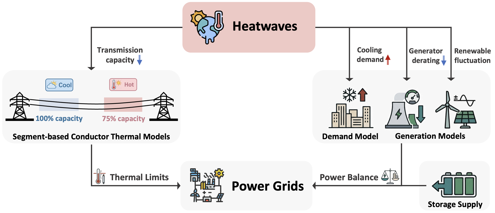
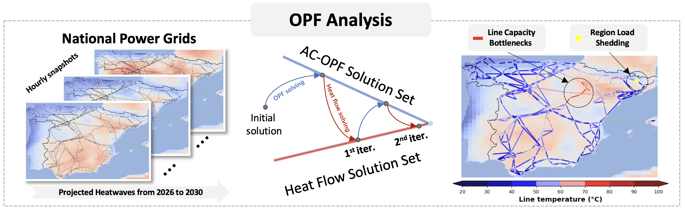

<p align="center">
  <h1 align="center">HeatAnalysis</h1>
  <p align="center">
    <b>Heatwave Impact on European Electricity Grids:<br>Temperature-Dependent Optimal Power Flow Framework</b>
  </p>
  <p align="center">
    <a href="#-quick-start"></a>
    <a href="LICENSE"></a>
    <a href="https://github.com/PyPSA/pypsa-eur"></a>
    <a href="https://coin-or.github.io/Ipopt/"></a>
    <a href="https://standards.ieee.org/ieee/738/6228/"></a>
    <a href="https://emliang.github.io/Heat-Analysis/"></a>
  </p>
  <p align="center">
    <a href="https://emliang.github.io/Heat-Analysis/">Project Page</a> &nbsp;|&nbsp;
    <a href="https://www.nature.com/articles/s41560-026-02151-1">Nature Energy Paper</a> &nbsp;|&nbsp;
    <a href="#-background">Background</a> &nbsp;|&nbsp;
    <a href="#-methodology">Methodology</a> &nbsp;|&nbsp;
    <a href="#-data-sources--flow">Data</a> &nbsp;|&nbsp;
    <a href="#-workflow">Workflow</a> &nbsp;|&nbsp;
    <a href="#-quick-start">Quick Start</a> &nbsp;|&nbsp;
    <a href="#-citation">Citation</a>
  </p>
</p>

---

## 🌡 Background

Climate change is increasing the frequency, intensity, and duration of [**heatwaves**](https://climate.copernicus.eu/heatwaves-brief-introduction) across Europe. These extreme heat events pose a **triple threat** to electricity grids:

- **Surging demand** — cooling loads spike during heatwaves, pushing peak consumption to record levels.
- **Reduced supply** — thermal and nuclear generators derate under high ambient temperatures; renewable output fluctuates with weather.
- **Degraded transmission capacity** — overhead conductors heat up, increasing resistance and sagging, which forces operators to reduce power flow to maintain safety clearances.

<p align="center">
  <br>
  <em>European summer (JJA) temperature anomalies relative to 1991-2020 baseline.
  Credit: <a href="https://climate.copernicus.eu/european-heatwave-july-2023-longer-term-context">C3S/ECMWF/KNMI</a></em>
</p>

Understanding these compounding effects is essential for enhancing grid resilience. This framework provides a **quantitative, physics-based assessment** of heatwave impacts on European power systems, from projected weather scenarios all the way to optimal power flow analysis.

---

## 🔬 Methodology

The framework integrates **climate projections**, **thermal modeling**, and **power system optimisation** into a unified simulation pipeline:

<p align="center">
  <br>
  <em>Overview of the HeatAnalysis framework: heatwaves simultaneously reduce transmission capacity (left),
  increase cooling demand, derate generators, and alter renewable output (right).</em>
</p>

The key methodological components are:

| Component | Description |
|-----------|-------------|
| **Future Heatwave Projection** | Generates projected heatwave events (2026-2030) via bias-corrected delta mapping from historical extremes (2019, 2022, 2024) onto climate projections |
| **Weather-Driven Demand Model** | BAIT thermal-comfort index calibrated against ENTSO-E hourly load data to capture temperature-demand coupling |
| **Renewable Generation** | Weather-driven capacity factors computed via [Atlite](https://github.com/PyPSA/atlite) for solar, onshore wind, and offshore wind |
| **Conductor Thermal Model** | IEEE Std 738-2012 heat-balance equation solved per line segment to obtain spatially-resolved conductor temperatures |
| **Multi-Segment Modelling** | Transmission lines subdivided along the ERA5 grid to capture localised thermal hotspots |
| **Generator Derating** | Temperature-dependent capacity reduction for conventional generators |
| **Iterative TD-ACOPF** | Temperature-dependent AC optimal power flow with electricity-temperature feedback over the configured iterations |

The iterative TD-ACOPF solver alternates between the AC-OPF solution (which determines branch currents) and the heat-balance equation (which determines conductor temperatures), updating network parameters at each step:

<p align="center">
  <br>
  <em>Iterative TD-ACOPF workflow: projected heatwave snapshots (left) are fed into the OPF ↔ heat-flow
  iteration loop (centre), producing spatially-resolved congestion and load-shedding maps (right).</em>
</p>

---

## 📁 Project Structure

```
Heat-Analysis/
├── TDOPF_eur.py / TDOPF_ieee.py   # TD-ACOPF entry points (European / IEEE)
├── data_config.py                  # Shared paths and model defaults
├── utils/                          # Library modules (heat flow, OPF, demand, …)
├── scripts/                        # Data download, calibration, profile building
├── tests/                          # Entry-point checks
├── webpage/                        # Project website
├── vis/                            # Visual examples and publication figure source
│   ├── demos/                      # Spain 2030 weather, grid inputs and one-hour solve
│   └── figure_source/              # Publication figure-data plotting scripts
├── data/                           # Included and separately prepared inputs
└── models/                         # Prepared profiles, saved results and figures
```

---

## 📊 Data Sources & Flow

| Source | Used for |
|--------|----------|
| [ERA5](https://cds.climate.copernicus.eu/datasets/reanalysis-era5-single-levels) | Hourly weather reanalysis (temperature, wind, radiation) |
| [EURO-CORDEX RCP 4.5](https://cds.climate.copernicus.eu/datasets/sis-energy-derived-projections) | Future climate projections for heatwave generation |
| [ENTSO-E](https://www.entsoe.eu/data/power-stats/) | Historical hourly country-level electricity demand |
| [PyPSA-Eur](https://pypsa-eur.readthedocs.io/) | European transmission network, bus regions, exclusion rasters |
| [Atlite](https://github.com/PyPSA/atlite) | Weather-driven renewable capacity factor calculation |

Historical mean availability derived from the PyPSA network is used where
matching future weather-driven renewable profiles are unavailable. The values
are averaged by month and hour and stored separately in
`data/EU/networks/historical_p_max_pu_s_{ratio}.nc`. They represent `p_max_pu`
(available output per unit of nominal capacity), not actual dispatched generation.
Matching Atlite profiles take precedence; missing or invalid input files still
raise an error rather than silently selecting a different input.

The bundled s_75 file contains the 72 month-hour combinations present in the
source network; the Spain example includes only its July 13:00 historical means.
Unrepresented months or hours are not extrapolated. For another network,
generate the file once from that network's original time series:

```bash
python scripts/prepare_renewable_history.py \
  --network data/EU/networks/base_s_75_elec.nc \
  --output data/EU/networks/historical_p_max_pu_s_75.nc
```

Regenerate this file if the source network changes. The simulation reads it once
per process and looks up each requested month and hour without recomputing means.

```
Historical weather + demand -> demand calibration -> demand curves
Weather + demand curves + network -> simulation-ready hourly profiles
                                       (main_build_simulation_profile.py)
                                                   |
                                                   v
                                    European TD-ACOPF (TDOPF_eur.py)
                                                   |
                                                   v
                                          Saved simulation results
```

`TDOPF_ieee.py` uses the bundled IEEE 30-bus case independently of the
European data pipeline. `scripts/main_heatwaves_generation.py` produces
optional weather illustrations; it is not required to build simulation inputs.

> Full file-level inventory: [`DATA_INPUT_SUMMARY.md`](data/DATA_INPUT_SUMMARY.md)

---


## 🔄 Workflow

The European workflow runs in this order: prepare weather, demand and network
inputs; calibrate the demand model; build simulation-ready hourly profiles;
run TD-ACOPF; then analyse the saved results. The prepared-input download below
can replace the input-generation stages. The IEEE benchmark is a separate entry
point and requires no European network or weather files.

## 🛠 Quick Start

```bash
git clone https://github.com/emliang/Heat-Analysis.git
cd Heat-Analysis
conda create -n heatanalysis python=3.10
conda activate heatanalysis
pip install -r requirements.txt
conda install -c conda-forge ipopt
```

### IEEE 30-bus smoke check

This check uses the case file included in the repository. It runs one load and
weather setting in two modes without overwriting the full IEEE sweep output.

```bash
python TDOPF_ieee.py --smoke
```

The check writes `models/IEEE30/30_heatflow_smoke.csv` and individual result
files under `models/IEEE30/record/heatflow_smoke/`. Running
`python TDOPF_ieee.py` without `--smoke` retains the full 108-case IEEE sweep
and writes to separate `heatflow_analysis` files. Both require an available
IPOPT executable.
The repository retains prepared inputs, saved results and figures under
`models/`. Smoke-check outputs and runs under `models/runs/` are ignored by Git.
The full IEEE sweep writes to existing result paths; use `HEATANALYSIS_MODELS`
to select a separate output directory when preserving the saved results.
Publication figure data are supplied separately in `vis/figure_source/`.

### European experiments

The prepared-input one-hour runner checks a manifest and its file hashes, then
runs the Spanish 2030-07-24 13:00 example in a separate output directory. It
uses the represented `s_75` network, the `2024_0` historical heatwave anchor,
1% annual base-demand growth, 80% initial storage state of charge and the
two-update temperature-dependent OPF setting. The small input bundle is
included in `data/examples/`, so this test needs no separate data download.
It is a workflow example, not an archive of the paper's results.

```bash
python scripts/run_european_example.py --bundle data/examples/es_2030-07-24_13_2024-0 --check-only
python scripts/run_european_example.py --bundle data/examples/es_2030-07-24_13_2024-0 --output-dir models/runs/european_example_2030
```

The run writes `results.csv`, `run_summary.json`, a copy of the checked input
manifest and the solver result file under the chosen directory. The output
directory must not exist before the run. A prepared-network run does not need
the PyPSA-Eur source checkout; generating new renewable profiles does.
The short [visual examples](vis/demos/README.md) use this same hour. The
[website](https://emliang.github.io/Heat-Analysis/) provides an interactive
view of its selected grid result without running the solver.

#### Full prepared-data experiments

The full prepared European inputs are available on Google Drive separately
from the bundled one-hour test:

> **[Download from Google Drive](https://drive.google.com/drive/folders/1SJmglPiEMTw--xggqzeiSjmKBCI17cnK)** (to skip the input-generation stages)
>
> The shared folder contains:
> - **Weather data** — ERA5 hourly & daily reanalysis, RCP 4.5 climate projections, elevation grid
> - **Simulation data** — pre-built heatwave scenarios and renewable capacity factors 
> - **EU grid data** — power-grid data derived from PyPSA-Eur
> - **PyPSA-Eur data** — configuration and data bundle for grid and profile preparation


After downloading:
1. Copy the `WeatherData/` folder from Google Drive into `data/` in this project.
2. Copy the pre-built country folders (e.g. `ES/`, `FR/`, `GB/`, ... from `SimuData/` in google drive) into `models/`. 
3. Copy `networks/` from `EUGrid` in google drive into `data/EU/`.

The European run also reads `data/EU/regions_onshore_base_s_75.geojson`,
`data/EU/load_ratio_base_s_75.csv`, country profiles under `models/{CC}/`,
and calibrated demand curves under `models/demand_curve/{CC}/`. Verify these
paths against the [file inventory](data/DATA_INPUT_SUMMARY.md) before starting
a batch; copying the network file alone is not sufficient.

Expected structure:
```text
Heat-Analysis/
├── models/
│   ├── ES/
│   ├── FR/
│   ├── demand_curve/
│   └── ...
└── data/
    ├── WeatherData/
    │   ├── era5/
    │   ├── rcp45/
    │   └── elevation.nc
    └── EU/
        ├── networks/
        ├── regions_onshore_base_s_75.geojson
        └── load_ratio_base_s_75.csv
```

`TDOPF_eur.py` remains the batch experiment entry point. It
expects the prepared input paths described in the file inventory below.
Building new renewable profiles also requires a configured PyPSA-Eur checkout.

> Detailed file inventory: [`DATA_INPUT_SUMMARY.md`](data/DATA_INPUT_SUMMARY.md) &
> [`data_config.py`](data_config.py).

---


**Full European pipeline** — from raw inputs to analysis:

Notebook stages use Jupyter Notebook, included in `requirements.txt`.
The IEEE check and prepared-input runners do not use Jupyter.

| Stage | What | Command |
|:-----:|------|---------|
| 0 | Download weather data | `jupyter notebook scripts/0.download_weather_data.ipynb` |
| 1 | Process weather profiles | `jupyter notebook scripts/1.process_weather_profile.ipynb` |
| 2 | Calibrate demand model | `python scripts/main_demand_calibration.py` |
| 3 | Build heatwave, demand and renewable simulation profiles | `python scripts/main_build_simulation_profile.py` |
| 4 | Run European TD-ACOPF batch experiments | `python TDOPF_eur.py` |

For optional visual inspection of generated weather conditions, run
`python scripts/main_heatwaves_generation.py`. The publication figure-source
workflow below starts from submitted figure data and is separate from these
simulation steps. For a guided visual example, see the three
[Spain 2030 notebooks](vis/demos/README.md).

Shared paths and model defaults are defined in `data_config.py`. Country,
year and experiment sweeps are set in the corresponding pipeline scripts and
solver entry points; review those settings before starting a full batch.
Generating new renewable profiles additionally requires
`data/EU/country_shapes.geojson` and `data/EU/offshore_shapes.geojson` from
PyPSA-Eur. These are not needed by the bundled one-hour example.

The `scripts/2.test_demand_calibration.ipynb`,
`scripts/3.test_creat_heatwaves.ipynb` and
`scripts/4.test_solve_heat_balance.ipynb` notebooks are optional method checks,
not additional pipeline stages or the recommended introductory notebooks.
They are retained as method references, including for publication-data
exporters; some require the full research inputs.

---

## Publication figure source

The [`vis/figure_source/`](vis/figure_source/) directory contains the frozen
data-to-figure scripts and the accompanying Source Data and Supplementary Data
ZIPs for manuscript `NENERGY-24102996D`. No separate data download is needed.
Its README maps each package to the plotting entry point and provides a single
command for checking all main and Extended Data figure reproductions.

---

## 📚 References

This project builds on the following standards, tools, and data sources:

- **IEEE Std 738-2012** — [IEEE Standard for Calculating the Current-Temperature Relationship of Bare Overhead Conductors](https://standards.ieee.org/ieee/738/6228/)
- **PyPSA-Eur** — [PyPSA-Eur: An Open Optimisation Model of the European Transmission System](https://doi.org/10.1016/j.enconman.2018.08.084), *Energy Conversion and Management*, 2019
- **ERA5 Reanalysis** — [The ERA5 Global Reanalysis](https://doi.org/10.1002/qj.3803), *Quarterly Journal of the Royal Meteorological Society*, 2020
- **ENTSO-E** — [Transparency Platform](https://transparency.entsoe.eu/)
- **Atlite** — [https://github.com/PyPSA/atlite](https://github.com/PyPSA/atlite)

---

## 🪪 License

This project is licensed under the **[Creative Commons Attribution 4.0 International (CC-BY-4.0)](LICENSE)**.

You are free to **share** and **adapt** the material for any purpose, provided you give appropriate attribution.

---

## ✨ Citation

Liang, E., Chen, M. & Keshav, S. **Heatwave-induced capacity bottlenecks in European electricity grids.** *Nature Energy* (2026). https://doi.org/10.1038/s41560-026-02151-1

Published 22 October 2026. [Read the article](https://www.nature.com/articles/s41560-026-02151-1) · [Download BibTeX](webpage/citation.bib).

```bibtex
@article{liang2026heatwave,
  title = {Heatwave-induced capacity bottlenecks in European electricity grids},
  author = {Liang, Enming and Chen, Minghua and Keshav, Srinivasan},
  journal = {Nature Energy},
  year = {2026},
  doi = {10.1038/s41560-026-02151-1},
  url = {https://www.nature.com/articles/s41560-026-02151-1}
}
```

---

## 🤝 Contributing

We welcome contributions from the community! Whether it's fixing a bug, improving documentation, or suggesting a new feature, your input helps make this project better.

1. **Fork** the repository
2. Create a **feature branch** (`git checkout -b feature/amazing-feature`)
3. **Commit** your changes (`git commit -m 'Add amazing feature'`)
4. **Push** to the branch (`git push origin feature/amazing-feature`)
5. Open a **Pull Request**

---

## 📬 Contact

If you have questions or encounter any issues, please [open an issue](https://github.com/emliang/Heat-Analysis/issues) on GitHub.
